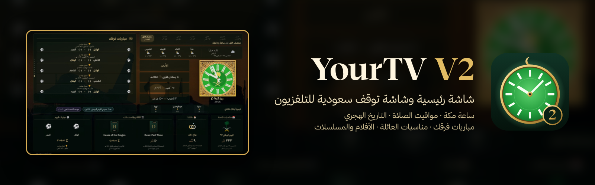

# YourTV V2

آخر نسخة تطوير: **4.10**. راجع [التعديلات وحالة الاختبار والقيود](V2-NOTES.md) قبل التثبيت.

نسخة تطوير بتوزيع موحد للشاشة الرئيسية وشاشة التوقف مع الحفاظ على التحكم بالجوال.

> **YourTV** — نسخة خاصة من [تلفزيونك](https://github.com/tshi-dev/UrTV): بدون الأسهم، ومكانها مواقيت الصلوات الخمس والصلاة التالية؛
> التاريخ «الثلاثاء ٩ (٥) جمادى الأولى ١٤٤٨ هـ»؛ عدّاد يتنقل كل ١٥ ثانية بين رمضان والعيدين واليوم الوطني ويوم التأسيس
> (بالأيام، وفي آخر يوم عدّ تنازلي بالثواني ثم التهنئة)؛ بطاقة جنب الساعة تتبدل كل ١٠ ثوانٍ (آية، حديث، الطقس، المباريات)؛
> وصور إضافية من [منصة الصور السعودية](https://cc.spa.gov.sa) (واس، CC BY-SA 4.0) مع وصف كل صورة. التحديث التلقائي من هذا المستودع.

<p align="center"></p>

<h1 align="center">تلفزيونك · UrTV</h1>

<p align="center" dir="rtl">واجهة رئيسية عربية وشاشة توقف سعودية لتلفزيونات Android TV و Google TV، وتسريع آمن للتلفزيون.<br>يركّبها لك مساعد ذكاء اصطناعي بأمر واحد.</p>

<p align="center">An Arabic home screen and a Saudi screensaver for Android TV / Google TV, and a safe speed-up.<br>Your AI agent sets it all up.</p>

<p align="center"></p>
<p align="center"></p>

<div dir="rtl">

## ركّبه بمساعد الذكاء الاصطناعي

1. **على التلفزيون:** الإعدادات ← النظام ← حول ← اضغط OK على **Build** سبع مرات ← خيارات المطوّر ← شغّل
   **USB debugging** (و**Network debugging** إن وُجد).
2. **على كمبيوتر في نفس شبكة الواي فاي**، افتح مساعد ذكاء اصطناعي يشغّل الأوامر على هذا الكمبيوتر نفسه (مثل Claude Code
   مثبّتاً عليه؛ المحادثة في المتصفح أو الجلسة السحابية ما توصل لتلفزيونك)، والصق:

   > ركّب تلفزيوني من https://github.com/tshi-dev/UrTV: انسخ المستودع واتبع `docs/SETUP-PROMPT.md` خطوة بخطوة. أنت على كمبيوتر متصل بنفس شبكة الواي فاي حقت التلفزيون.

   على ويندوز: في PowerShell الصق الأسطر الثلاثة تحت (في القسم الإنجليزي)، ثم افتح PowerShell جديد واكتب `claude`،
   أو استخدم تبويب Code في تطبيق Claude على سطح المكتب مع مجلد على جهازك (مو بيئة سحابية).
   وإذا تستخدم Codex: اختر «Approve for me» للموافقات من القائمة تحت خانة الكتابة (المساعد يذكّرك أول شي).
   وأول ما يسويه المساعد أنه يتأكد أنه يقدر يوصل لشبكة بيتك؛ وإذا ما قدر يقولك بوضوح.

وبس. المساعد يتصل بالتلفزيون، ويحفظ أول 6 تطبيقات مفضلة من واجهتك الحالية، ويسألك سؤالين: مدينتك، والأندية اللي
تتابع مبارياتها. والباقي يقولك وش افتراضيه وتقدر تغيّره: جنب الساعة «آية وحديث اليوم»، ويركّب TV Bro (متصفح) وSmartTube
(يوتيوب بدون إعلانات). بعدها يكمل الباقي في حوالي 40 دقيقة، ويقيس الذاكرة
قبل وبعد. وأي شي ثاني تقدر تغيّره بعدين.

**آمن:** ما يحذف أي تطبيق، وما يلمس AirPlay ولا Chromecast ولا عرض الشاشة ولا الصوت ولا المداخل، وتبديل الواجهة
فيه رجوع تلقائي بعد 5 دقائق، و`optimize/reset.sh` يرجّع التلفزيون مثل ما كان.

</div>

## Set it up with your AI agent

1. **On the TV:** Settings → System → About → press OK on **Build** 7 times → Developer options → turn on
   **USB debugging** (and **Network debugging** if listed).
2. **On a computer on the same Wi-Fi**, open an AI agent that runs commands on that computer itself (for example
   Claude Code installed on it; a browser chat or a cloud session can't reach your TV), and paste:

   > Set up my TV with https://github.com/tshi-dev/UrTV: clone it and follow `docs/SETUP-PROMPT.md` step by step. You are on a computer on the same Wi-Fi as the TV.

   Windows, in PowerShell, then a new PowerShell window and `claude` (or the desktop app's Code tab on a local folder):
   ```
   winget install -e --id Git.Git
   winget install -e --id Python.Python.3.12
   irm https://claude.ai/install.ps1 | iex
   ```
   Codex: choose «Approve for me» for approvals in the menu under the chat box (the agent reminds you first).
   The agent's first step checks that it can reach your home network, and says so plainly if it can't.

That's it. The agent connects, keeps your 6 favourite apps from the current home screen, asks two questions (your
city, the clubs whose games you follow) and tells you the defaults you can change: verse and hadith beside the
clock, and TV Bro (a browser) and SmartTube (YouTube without ads) installed, free from their own GitHub. Then it does
the rest in about 40 minutes, measuring memory before and after. Anything else can be changed later.
The full prompt is in [docs/SETUP-PROMPT.md](docs/SETUP-PROMPT.md) if you want to read or adapt it.

**Safe by design:** nothing is uninstalled; AirPlay, Chromecast, mirroring, voice and inputs are never touched;
the home-screen switch has a 5-minute automatic fallback, and `optimize/reset.sh` puts the TV back as it came.

**Make your own:** to build a different screen or port it to another TV, give your agent this repo and
[docs/RECREATE-PROMPT.md](docs/RECREATE-PROMPT.md) (the full design and behaviour spec).

## What you get

| | | |
|---|---|---|
| **شاشة تلفزيونك** · screensaver | Clock, Hijri date, prayer times and iqama, Ramadan, your teams' matches, weather, markets, and beside the clock your choice of new episodes, today's prayers, the 5-day forecast, all your teams' games, or a verse/hadith of the day, over Saudi landscapes | `urtv-screensaver.apk` |
| **تلفزيونك** · home screen | Clean Arabic launcher: favourites row (5–10 apps) arranged in «ترتيب المفضلة», all apps, inputs, Wi-Fi, settings; optional card from the screensaver (off by default) | `urtv-home.apk` |
| **Two free apps** | [TV Bro](https://github.com/truefedex/tv-bro), a web browser for the TV, and [SmartTube](https://github.com/yuliskov/SmartTube), YouTube without ads, from their own releases (skip with `SKIP_EXTRAS=1`) | `optimize/install.sh extras` |
| **Speed-up** | Telemetry, ads and demos off (reversibly), closed apps frozen, Play Store kept from running in the background, faster animations | `optimize/` |

**Download the apps yourself:** [releases/apk-latest](https://github.com/tshi-dev/UrTV/releases/tag/apk-latest)
(install with `adb install`; the agent route above also sets everything up).
Every build is also kept as a numbered release (`v3.N`, the apps' version), to go back to one:
`APK_TAG=v3.N optimize/install.sh all`.

## For agents and scripts

Everything is scriptable over ADB, made for slow Wi-Fi (retries, resumable uploads, every step remembered):

| | |
|---|---|
| `optimize/find-tv.sh` | `--check`: can this terminal reach the home network at all (not from a cloud or sandbox) · then finds the TV (Windows, Mac, Linux) |
| `optimize/run.sh` | the whole setup; run again after any failure to continue · `status` |
| `optimize/saver.sh` | screensaver settings: `city`, `teams`, `find-team`, `card`, `home-card`, `update`, `show` |
| `optimize/dock.sh` | favourites row: `apps`, `set`, `show`, `reset` |
| `optimize/measure.sh` · `shot.sh` | memory before/after (restart + settle) · screenshots without navigating |
| `optimize/keep.sh` | turn back on anything protected (AirPlay, casting, voice, updates…) that something turned off |
| `optimize/reset.sh` | back to stock: lists re-enabled, stock home and screensaver back, our apps removed |

What we learned on real TCL sets, and what must stay on: [docs/OPTIMIZE.md](docs/OPTIMIZE.md). Manual test plan:
[docs/TEST-PLAN.md](docs/TEST-PLAN.md).

## For developers

```
src/template.html     the screen (HTML/CSS/JS, no framework); edit this, then run src/build.py
src/build.py          builds the two pages in dist/
dist/urtv.html        stand-alone page, fonts and photos inlined: open in any browser (F = full screen), works offline
dist/tv.html          light page the Android app loads (0.1 MB); the app serves fonts and photos from disk
android/app           the screensaver app (sa.yourtv.v2.screensaver): DreamService, settings, auto-update
android/launcher      the home screen (sa.yourtv.v2.home)
assets/               fonts, bundled photos, Arabic team names, verse and hadith texts
photos/               the hosted photo set (5 shown per 4 days, rotating every 30 min)
optimize/             TV tools (Python ADB client, no adb binary needed); lists/ says what may be turned off
docs/                 the agent prompts (setup, recreate), what we learned on real TVs, test plan, photo credits
.github/              CI: APK builds, checks, data tools (verses, hadith, clubs, photos), README images
tests/run.sh          every check: build, data, fonts, scripts, private data, flaky-ADB upload, the screen in a browser
```

Every push builds both APKs in GitHub Actions and publishes them to the `apk-latest` release; `tests/run.sh` runs
on every push too. Local Android build (needs the SDK): `python3 src/build.py && gradle -p android assembleRelease`
(signed with the debug key; the release key lives only in the repository's secrets).

**Screen settings** come from the URL fragment (works on `file://` and in WebView):

```
urtv.html#city=جدة&lat=21.5433&lon=39.1728&tz=Asia/Riyadh&teams=136013,136137&panel=prayers
```

`teams`: up to 10 TheSportsDB ids in priority order. `panel`: the card beside the clock: `shows`, `prayers`,
`forecast`, `matches`, `verse` or `none`. Also `genres`, `langs`, `shows`, `minrating` for the episodes card.

**Data** (free, no keys): Aladhan (prayer times, Umm al-Qura), Open-Meteo (weather), Yahoo and CoinGecko (markets),
TVMaze (episodes), TheSportsDB (matches). Everything fails soft: offline, the clock, dates, prayer and Ramadan
countdowns still work and the last good data stays on screen. A finished game's score stays up for a day.

**Verse and hadith texts are never typed by hand:** verses come from the Quran API via CI
(`.github/tools/fetch_verses.py`); each hadith is checked by CI (`.github/tools/verify_hadith.py`) against the
Arabic text of the six Sunni books, and only those found are shown, with the books as the source line.

**The Android apps** update the screen page from this repo every 6 hours (so it must stay public), start fast
(the page shows once the clock, saved panels and photo are ready), and come back after a power cut.

## Credits

Photos: Unsplash photographers, listed in [docs/PHOTO-CREDITS.md](docs/PHOTO-CREDITS.md). Fonts: Thmanyah, and
Noto Naskh Arabic for ﷺ ﴿﴾ (OFL, `assets/fonts/`).
Home screen adapted from [mihirgupta0900/tv-home](https://github.com/mihirgupta0900/tv-home) (MIT,
`android/launcher/LICENSE-tv-home`). Package ratings from [UAD-ng](https://github.com/Universal-Debloater-Alliance/universal-android-debloater-next-generation).
